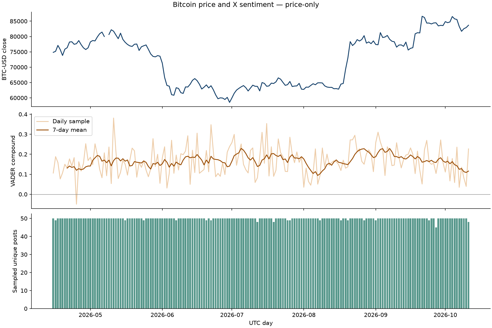
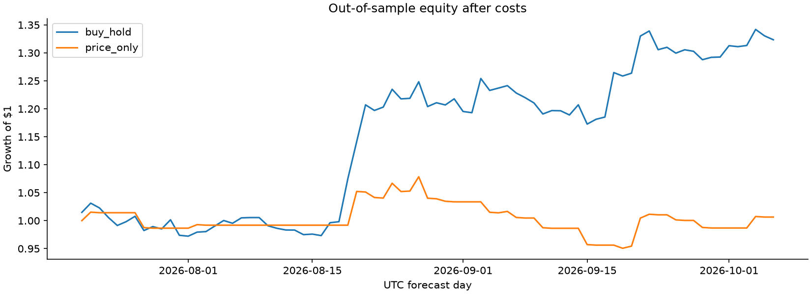
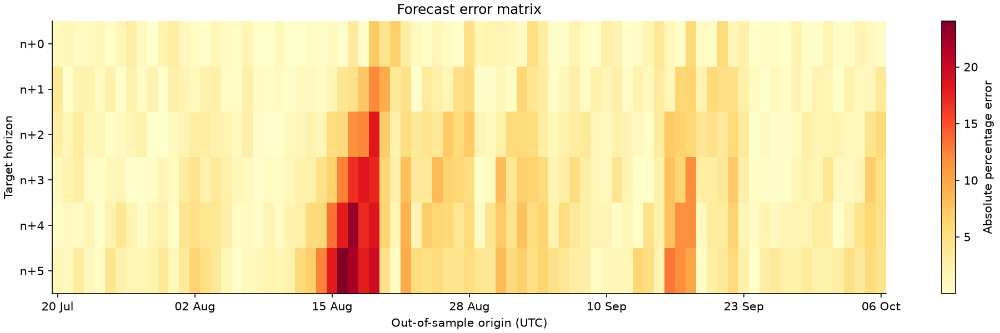
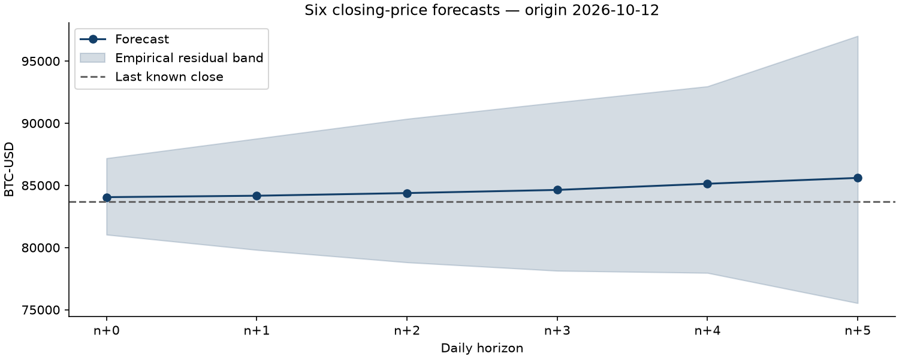

# Bitcoin forecasting evaluation

**Status: Price-only benchmark — X features excluded.** Generated 2026-10-12T16:19:32.230055+00:00.

The price_only model's n+0 MAE is $1,099.36, compared with $971.59 for persistence. Its error is 13.2% higher than the no-change baseline. The model and trading rule were not retuned to improve this result.

## Experiment

The model predicts six daily closing prices. At 00:05 UTC on day n, it uses prices and sampled posts through the end of n−1. The n+0 target is the close of day n, not an already observed spot price. The remaining targets are closes of n+1 through n+5. Stored timestamps are UTC; forecast exports also show America/New_York, including daylight-saving changes.

The first test origin is 2026-07-20; the last is 2026-10-06. There are 79 distinct test origins. Training expands every 14 calendar days, with at least 60 training rows. Each horizon excludes every training label ending after its fold cutoff. Features and scaling are fit on training rows only. Ridge regularization is fixed at 10 before evaluation. The price-only ablation uses the same training rows and origins as the sentiment model. Persistence predicts the last observed close.

## Forecast accuracy

| model | horizon | observations | mae_usd | rmse_usd | mape_pct | return_mae | direction_accuracy |
| --- | --- | --- | --- | --- | --- | --- | --- |
| persistence | 0 | 79 | 971.5887 | 1547.6889 | 1.2925 | 0.0130 | N/A |
| persistence | 1 | 79 | 1504.5699 | 2260.2803 | 1.9930 | 0.0202 | N/A |
| persistence | 2 | 79 | 1925.0416 | 2906.9387 | 2.5313 | 0.0259 | N/A |
| persistence | 3 | 79 | 2294.5042 | 3538.6125 | 2.9896 | 0.0308 | N/A |
| persistence | 4 | 79 | 2614.1068 | 4077.7779 | 3.3960 | 0.0352 | N/A |
| persistence | 5 | 79 | 2953.3503 | 4553.4757 | 3.8192 | 0.0397 | N/A |
| price_only | 0 | 79 | 1099.3617 | 1646.1326 | 1.4607 | 0.0147 | 0.4430 |
| price_only | 1 | 79 | 1777.6271 | 2468.3364 | 2.3465 | 0.0237 | 0.4937 |
| price_only | 2 | 79 | 2385.3704 | 3327.2082 | 3.1285 | 0.0318 | 0.4304 |
| price_only | 3 | 79 | 2812.9862 | 4115.0193 | 3.6695 | 0.0376 | 0.4937 |
| price_only | 4 | 79 | 3246.7940 | 4751.7775 | 4.2298 | 0.0438 | 0.5316 |
| price_only | 5 | 79 | 3746.8368 | 5356.9250 | 4.8680 | 0.0507 | 0.4937 |

MAE/RMSE are in USD. MAPE is in percent. Return MAE uses log returns. Direction accuracy is a fraction; persistence has no directional call. Overlapping multi-day targets are not independent observations. No significance or reliable future-profit claim follows from this short sample.

## Trading evaluation

Only the n+0 forecast drives the strategy. A predicted log return above 0.002 creates a long position; otherwise the strategy holds cash. This threshold was fixed before evaluation. Orders are modeled at the 01:00 UTC hourly open, 55 minutes after the forecast cutoff. Holdings earn the return to the next day's 01:00 open. There is no shorting or leverage. Costs apply to every position change and the final liquidation; sensitivity results show 0, 10 and 25 basis points per side. Hourly open execution is an approximation, not an order-book simulation.

| model | cost_bps | days | total_return | sharpe | sortino | max_drawdown |
| --- | --- | --- | --- | --- | --- | --- |
| price_only | 0 | 79 | 0.0371 | 0.8107 | 1.4706 | -0.1078 |
| price_only | 10 | 79 | 0.0064 | 0.2399 | 0.4211 | -0.1185 |
| price_only | 25 | 79 | -0.0379 | -0.6128 | -1.0210 | -0.1344 |
| buy_hold | 10 | 79 | 0.3234 | 3.4860 | 7.7482 | -0.0650 |

Sharpe = sqrt(365) × mean daily net return / sample standard deviation. Sortino uses the root mean square of negative daily returns, including zero for non-negative days. Both use a zero risk-free rate and a zero minimum acceptable return. Undefined ratios are N/A. Maximum drawdown is the worst equity decline from a prior peak, including the initial $1. Ratios are annualized, but the test does not span a year. Buy-and-hold covers the identical test dates and pays entry/exit costs.

Total return and maximum drawdown are fractions: −0.10 denotes a 10% loss. The complete joined daily dataset and model features are materialized in SQLite for inspection.

## Data quality and limitations

Coverage flags are available for 99.4% of joined dates (including the next forecast day). X searches are daily capped samples ordered by recency, not the full population. Sample volume must not be described as total platform volume. Duplicated IDs and copied text within a day are removed. Missing scraping days remain missing rather than becoming neutral sentiment. Historical text is a retrospective snapshot: deleted/edited posts and search selection still introduce survivorship and selection bias. This is historical out-of-sample research, not a point-in-time archive or a live trading record.

Price days with fewer than 24 hourly candles: 2026-05-08. Those daily OHLC values and affected feature windows are excluded, not interpolated.

Likes, reposts, views and follower counts are stored for inspection but excluded from forecasting: their current values were not necessarily known at historical forecast time. Tavily news supplements the current outlook only and is excluded from all historical features. VADER measures general English tone, not reliably bullish/bearish investment intent; sarcasm and crypto jargon require manual review. 180 days provide a limited number of independent market regimes.

## Reproduction and artifacts

See README.md for exact commands, docs/METHODOLOGY.md for timing assumptions, and run_manifest.json for the environment and database hash. fold_audit.csv records the final training label boundary for every fold. predictions_oos.csv contains every untouched test prediction. forecast.csv contains the latest six outputs. Empirical bands use the 90th percentile of prior out-of-sample absolute log-return errors after their labels mature; these are descriptive residual bands, not guaranteed prediction intervals.

